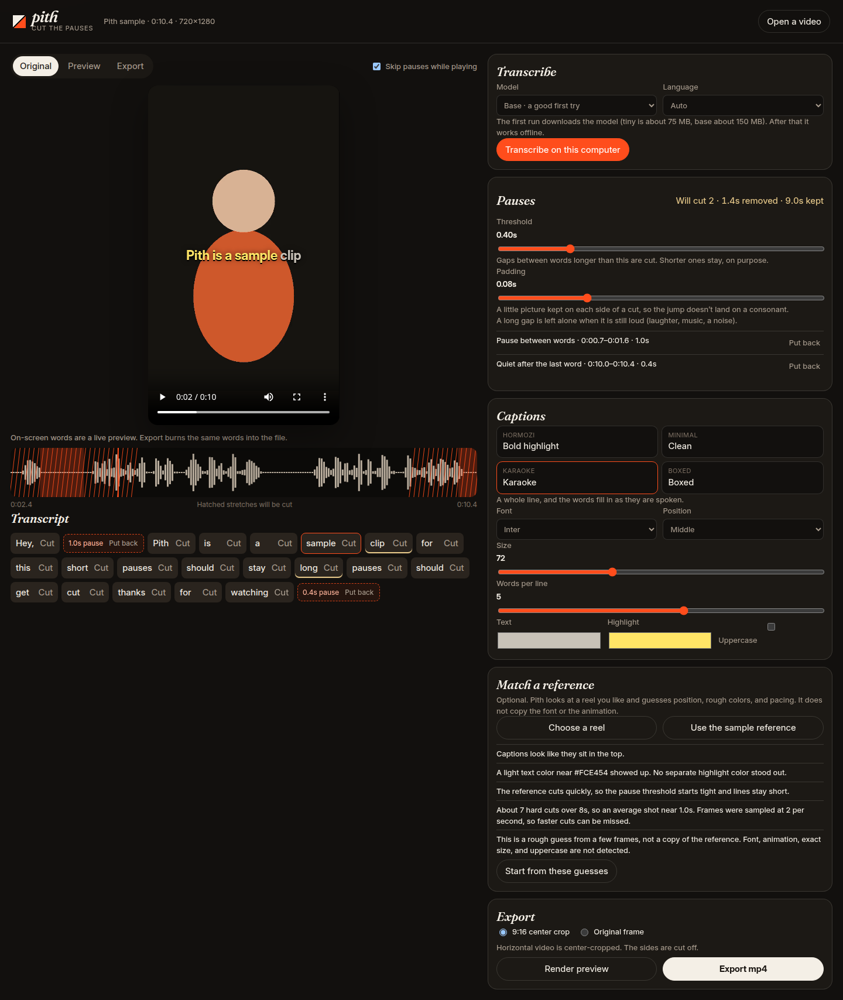
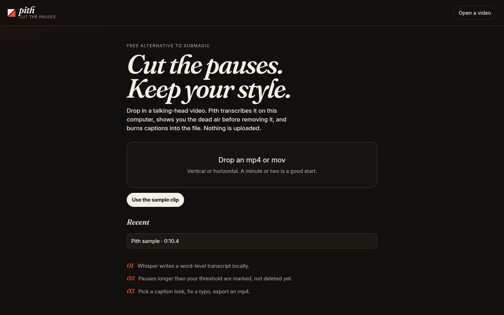
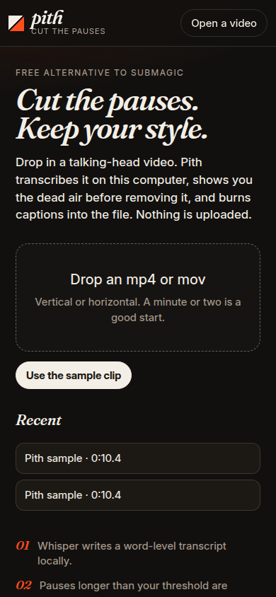

# Pith

Cut the pauses. Keep your style.

Pith is a free, open-source alternative to [Submagic](https://submagic.co). Submagic is a paid web app that auto-captions short videos and cuts silences. Pith does that job on your own computer. The core flow never uploads the video and does not need an account or an API key.

It is the portfolio piece behind Cobble, a reels editor whose pitch is: cut the pauses in my style.



The burned-in export. The highlighted word is the one being spoken:


## What it does

- Import a talking-head video, mp4 or mov, vertical or horizontal.
- Transcribe it locally with [faster-whisper](https://github.com/SYSTRAN/faster-whisper). You get a word, a start time, and an end time. The first run downloads a model (tiny is about 75 MB, base about 150 MB, small about 500 MB). After that it works offline.
- Find dead air from the gaps between words, and from the volume. A pause shorter than the threshold stays. Padding keeps a little picture on each side of a cut so the jump does not land on a consonant. A long gap that is still loud (laughter, music) is left in, and the window says so.
- Burn in captions. Four starting looks: bold word-by-word highlight, clean, karaoke, and boxed. You can change the font, size, colors, highlight, position, words per line, and uppercase.
- Match a reference reel. Pith guesses where the captions sit, a rough text color, and how fast the reference cuts, then offers that as a starting point. It tells you what it did not detect: font, animation, exact size, uppercase.
- Edit. Restore a cut, delete a word or a segment, fix a typo, and the plan updates. A live preview sits on the original video. Export is what actually burns the words in.
- Export an mp4 with ffmpeg. Audio is trimmed with the same timestamps as the picture. Choose the original frame, or 9:16 with a center crop.

Pith does not auto-zoom, track a face, add music, or pick the best of several takes. Those are on the roadmap.

## Download

These are double-click apps. You do not install Python. ffmpeg is inside the download. The first transcription still downloads a Whisper model (base is about 150 MB) into your user folder. After that, transcription works offline.

The builds are unsigned.

| Computer | File | How you get it |
| --- | --- | --- |
| Mac, Apple silicon | `Pith-macOS-arm64.dmg` | GitHub Actions artifact, or the Release on a `v*` tag |
| Mac, Intel | `Pith-macOS-x86_64.dmg` | same |
| Windows 10 or 11, 64-bit | `Pith-Windows-x64.zip` | same |

Open the dmg and drag Pith to Applications, or unzip the Windows zip and double-click `Pith.exe`. Each zip also has `INSTALL.txt` with the same warnings as below.

**macOS Gatekeeper.** Finder says Pith is from an unidentified developer. Right-click Pith, choose **Open**, then **Open** again. A normal double-click only shows the warning.

**Windows SmartScreen.** Windows may say "Windows protected your PC". Choose **More info**, then **Run anyway**. That warning is about the missing code signature. Windows 11 can open the desktop window. Windows 10 needs the Evergreen WebView2 runtime for that window. If the window cannot open, Pith opens in your browser.

The Mac and Windows files are built on native runners, because PyInstaller cannot cross-compile and the speech libraries are native wheels. This repository includes:

- `.github/workflows/build-apps.yml` for GitHub Actions, including when the repo is mirrored to GitHub. Pushing a tag like `v0.1.0` also attaches the files to a GitHub Release.
- `.depot/workflows/build-apps.yml` for Depot CI on Origin. Download the job artifacts. That copy does not publish a GitHub Release.

Run the workflow with **workflow_dispatch**, or push a `v*` tag. Each job builds the app and launches it far enough to answer `/api/health`.

On Linux, `python scripts/package.py` writes `Pith-Linux-x86_64.zip` and `Pith-Linux-x86_64.tar.xz`. That Linux build is the one verified here: the binary launches, finds the bundled ffmpeg, and answers `/api/health`. It is not a Mac or Windows app. The verified tarball is `Pith-Linux-x86_64.tar.xz`, sha256 `08a76f276c8b3b2ffdada2b2013ffb23ac3c2f79bca41d42d4675b0f53554941`. If it arrives as `.part-aa` and `.part-ab`, join them with `cat Pith-Linux-x86_64.tar.xz.part-* > Pith-Linux-x86_64.tar.xz` before unpacking.

## Install from source

You need Python 3.10 or newer. You do not need to install ffmpeg yourself. Pith brings one through `imageio-ffmpeg`, and uses it only if it can encode H.264 and burn ASS captions.

macOS or Linux:

```bash
python3 -m venv .venv
source .venv/bin/activate
pip install -r requirements.txt
python -m pith
```

Windows:

```bat
py -m venv .venv
.venv\Scripts\activate
pip install -r requirements.txt
python -m pith
```

That opens a desktop window on [http://127.0.0.1:8734](http://127.0.0.1:8734) (or the next free port). The server listens on your machine only. If a desktop window is not available, Pith opens your browser instead.

```bash
python -m pith --browser      # skip the desktop window
python -m pith --no-window    # serve only, for tests
```

The empty window:



On a phone-width window the same page stacks:



## Use it

1. Open an mp4 or mov, or click **Use the sample clip**. The sample is a 10 second vertical fixture with a drawn figure, a few sentences, and planted pauses. It is not a real person.
2. Pick a model. **Base** is the right first try. **Tiny** is faster and mishears more. **Small** is slower and clearer.
3. Click **Transcribe on this computer**. Words show up with a Cut button. Hatched stretches on the timeline are what will be removed. **Put back** keeps one.
4. Fix a typo by editing the word. Cut a filler word and that stretch of time goes with it.
5. Pick a caption look and nudge the sliders. The words on the video are a live preview. They are not in the file until you export.
6. Optional: **Match a reference** with another reel, read the notes, then **Start from these guesses** if you want them.
7. **Render preview** for a fast low-resolution check, or **Export mp4** for the full file. 9:16 center-crops a horizontal video. The sides are cut off. The file is also saved in the project folder, and the window gives you a download.

Projects live in `~/.pith/projects`. A log is at `~/.pith/pith.log`.

## How it works

The window is a small local website. `python -m pith` starts it and opens it. The edit math stays in Python so the preview and the export cannot disagree.

1. `pith/transcribe.py` runs faster-whisper with word timestamps. Punctuation is glued back onto the word it belongs to.
2. `pith/silence.py` groups words into phrases when the gap is shorter than the threshold, pads each phrase, then punches out words you deleted. A gap is rescued only when it is clearly loud next to the speech around it.
3. `pith/captions.py` writes an `.ass` subtitle file. Each line is a few words. The line is rewritten once per word with the active word in the highlight color. Times in that file are output times, after the cuts, so the highlight stays on the voice.
4. `pith/export.py` trims picture and audio with the same start and end, concatenates them, then burns the subtitles. Phone video that is stored sideways is turned upright by ffmpeg before the filters, and Pith sizes the frame from the upright dimensions.
5. `pith/reference.py` samples a few frames. A caption is a small patch of bright or colored pixels, not a bright wall and not a face. Shot length comes from frame-to-frame jumps. The notes say what that cannot see.

The files you would edit first:

| File | What it owns |
| --- | --- |
| `pith/presets.py` | The four caption looks |
| `pith/silence.py` | What counts as a pause |
| `pith/captions.py` | How a look becomes subtitles |
| `pith/reference.py` | The reference guess |
| `pith/static/` | The window |

## Tests

The logic tests do not download a model:

```bash
pip install -r requirements-dev.txt
pytest
```

They cover short pauses that stay, long pauses that go, padding that swallows a barely-long cut, deleted words, restored pauses, caption times after a cut, and a real ffmpeg export where a beep and a white square stay together after the cut.

This one downloads the tiny model if you do not have it, transcribes the sample, cuts, and exports:

```bash
python -m pith --self-test
```

Regenerate the sample clips (needs `espeak-ng` or `espeak`):

```bash
python scripts/make_sample.py
```

## Package a downloadable app

Build on the operating system the download should run on. A Windows build only runs on Windows, and the same is true for Mac and Linux. Cross-compiling is not supported.

```bash
pip install -r requirements.txt -r requirements-dev.txt
python scripts/package.py
python scripts/smoke_frozen.py
```

`scripts/package.py` writes `dist/Pith-macOS-arm64.dmg` (and a zip of `Pith.app`) on Apple silicon, `dist/Pith-macOS-x86_64.dmg` on Intel Macs, `dist/Pith-Windows-x64.zip` on Windows, and `dist/Pith-Linux-x86_64.zip` on 64-bit Linux. The Whisper model is not inside the archive. The first transcription downloads it.

`scripts/smoke_frozen.py` runs the packaged binary, checks that fonts, the window, the sample, and ffmpeg are inside it, then starts it and requests `/api/health`.

## Roadmap

- **Best-take picker.** Import a few takes of the same line, line the words up, and keep the take with fewer pauses and cleaner audio.
- **Hook tester.** Score the opening seconds: does a line land before the first long pause, and is there a caption in that window?
- Blur-pad reframing, so a horizontal video can become 9:16 without losing the sides.
- Your own font files.
- GPU transcription.
- A folder of clips, exported in one go.

## License

MIT. See [LICENSE](LICENSE).

The caption fonts are Anton, Inter, Oswald, and Fraunces, each under the SIL Open Font License. The license texts are in `pith/fonts/licenses/`.
